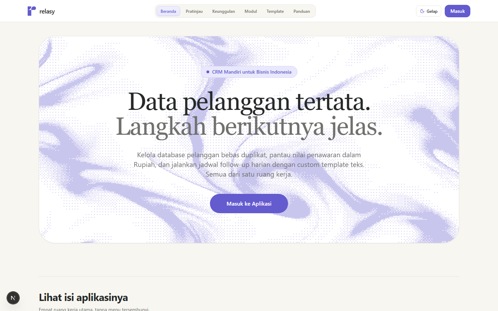
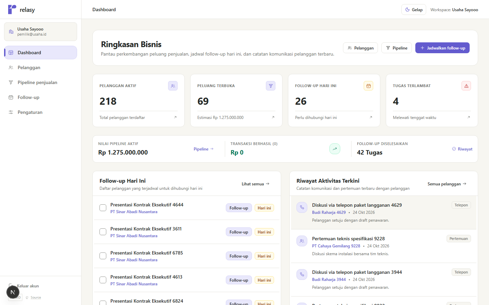
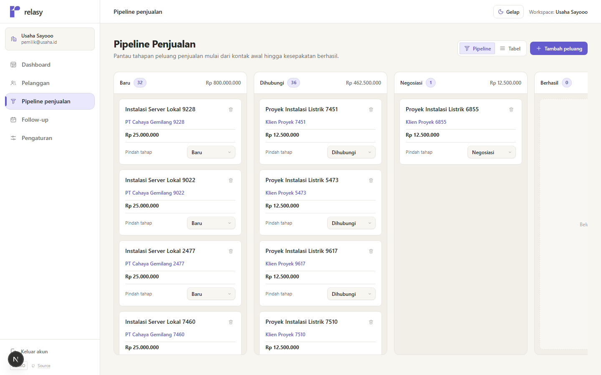

# Relasy

**CRM mandiri untuk bisnis Indonesia.** Kelola data pelanggan, pantau pipeline penjualan dalam Rupiah, dan jadwalkan follow-up tanpa integrasi eksternal yang rumit.



> **Ini versi demo.** Repositori publik ini memuat source code untuk dibaca dan dinilai. Versi lengkap, termasuk hak pakai komersial, dijual terpisah. Lihat [Membeli source code](#membeli-source-code) di bagian paling bawah.

---

## Daftar isi

- [Kenapa Relasy](#kenapa-relasy)
- [Fitur](#fitur)
- [Tangkapan layar](#tangkapan-layar)
- [Teknologi](#teknologi)
- [Menjalankan secara lokal](#menjalankan-secara-lokal)
- [Akun demo](#akun-demo)
- [Pengujian](#pengujian)
- [Struktur proyek](#struktur-proyek)
- [Keputusan desain](#keputusan-desain)
- [Membeli source code](#membeli-source-code)

---

## Kenapa Relasy

Sebagian besar CRM dibangun untuk tim penjualan besar dengan proses yang sudah mapan. Pemilik usaha kecil justru butuh sebaliknya: satu tempat untuk menjawab tiga pertanyaan setiap pagi.

1. Pelanggan mana yang perlu saya hubungi hari ini?
2. Peluang mana yang paling dekat closing?
3. Apa langkah berikutnya untuk tiap pelanggan?

Relasy menjawab ketiganya di satu layar, dengan bahasa Indonesia yang wajar dan format Rupiah asli. Tidak ada grafik hiasan, tidak ada metrik karangan, tidak ada integrasi yang harus disiapkan lebih dulu.

**Prinsip yang dipegang:**

- **Data milik Anda.** Database SQLite lokal di mesin Anda sendiri, tanpa layanan pihak ketiga.
- **Jujur pada keadaan.** Angka di dashboard berasal dari data nyata. Kondisi kosong menampilkan langkah berikutnya, bukan angka palsu.
- **Cepat dipakai.** Tanpa onboarding berlapis, tanpa konfigurasi wajib.

---

## Fitur

### Ringkasan bisnis

Dashboard yang menempatkan pekerjaan penjualan di depan, bukan dinding kartu KPI.

- Metrik nyata: pelanggan aktif, peluang terbuka, total nilai pipeline, follow-up hari ini, tugas terlambat, peluang menang.
- Daftar follow-up hari ini dengan penyelesaian langsung lewat dialog konfirmasi.
- Riwayat aktivitas terbaru lintas pelanggan.
- Setiap kartu metrik menaut ke daftar data terkait.

### Data pelanggan

- Pencatatan nama, telepon/WhatsApp, email, perusahaan, sumber kontak, dan catatan kebutuhan.
- Pencarian instan serta penyaringan status Aktif dan Diarsipkan.
- Halaman rincian dengan linimasa aktivitas, peluang terbuka, dan jadwal follow-up.
- Arsip, pemulihan, dan penghapusan dengan konfirmasi.
- Impor CSV dengan pratinjau validasi: baris valid, duplikat, dan tidak valid dihitung terpisah sebelum disimpan.
- Ekspor CSV yang mempertahankan angka nol di depan pada nomor telepon.

### Pipeline penjualan

- Lima tahapan: **Baru**, **Dihubungi**, **Negosiasi**, **Berhasil**, **Tidak berhasil**.
- Dua tampilan: papan Kanban dan tabel ringkas.
- Total nilai per tahap dalam format Rupiah.
- Perubahan tahap lewat dropdown yang tetap bisa dioperasikan dengan keyboard.

### Aktivitas dan follow-up

- Lima jenis interaksi: Catatan, Telepon, Pertemuan, Pesan manual, Lainnya.
- Empat tab: Hari ini, Mendatang, Terlambat, Selesai.
- Penjadwalan ulang tenggat dan pembaruan status dengan konfirmasi eksplisit.
- Template teks follow-up otomatis yang bisa diaktifkan dan disesuaikan, lalu disalin ke WhatsApp.

### Pengaturan

- Nama usaha dan profil pemilik.
- Status database lokal dan penjelasan isolasi data per workspace.

---

## Tangkapan layar

| Tampilan | Berkas |
| --- | --- |
| Beranda | `docs/screenshots/01-beranda.png` |
| Pratinjau aplikasi | `docs/screenshots/02-pratinjau.png` |
| Masuk | `docs/screenshots/03-masuk.png` |
| Ringkasan bisnis | `docs/screenshots/04-dashboard.png` |
| Data pelanggan | `docs/screenshots/05-pelanggan.png` |
| Pipeline penjualan | `docs/screenshots/06-pipeline.png` |
| Follow-up | `docs/screenshots/07-follow-up.png` |





---

## Teknologi

| Lapisan | Pilihan |
| --- | --- |
| Framework | Next.js 15 (App Router), React 19, TypeScript |
| Styling | Tailwind CSS dengan token warna eksplisit |
| Database | SQLite lokal lewat `node:sqlite` (`DatabaseSync`, WAL, foreign keys) |
| Autentikasi | Sesi HMAC-SHA256, kata sandi `bcryptjs` |
| Validasi | `zod` di sisi server |
| Animasi | Framer Motion, menghormati `prefers-reduced-motion` |
| Pengujian | Vitest untuk unit dan integrasi, Playwright untuk end-to-end |

Tidak ada layanan eksternal, tidak ada API key pihak ketiga, tidak ada telemetri.

---

## Menjalankan secara lokal

### Persyaratan

- Node.js 20 atau lebih baru. `node:sqlite` memerlukan Node 22+ untuk build produksi yang stabil.
- npm 10 atau lebih baru.

### Langkah

```bash
# 1. Pasang dependensi
npm install

# 2. Siapkan environment
cp .env.example .env.local

# 3. Jalankan server pengembangan
npm run dev
```

Buka `http://localhost:3005`.

### Build produksi

```bash
npm run build
npm start
```

> **Catatan:** jangan menjalankan `npm run build` saat `npm run dev` masih aktif. Keduanya memakai direktori `.next` yang sama dan dapat merusak cache. Hentikan dev server, hapus `.next`, lalu build.

### Environment

| Variabel | Keterangan |
| --- | --- |
| `NEXT_PUBLIC_APP_URL` | URL aplikasi, default `http://localhost:3005` |
| `SESSION_SECRET` | Kunci penandatanganan sesi, minimal 32 karakter di produksi |
| `DATABASE_PATH` | Lokasi berkas SQLite, default `./data/relasy.db` |

---

## Akun demo

Saat pertama kali dijalankan, aplikasi membuat akun bawaan:

- **Email:** `pemilik@usaha.id`
- **Kata sandi:** `relasy123`
- **Workspace:** Usaha Saya

Ganti kredensial ini sebelum menempatkan aplikasi di lingkungan yang dapat diakses publik.

---

## Pengujian

```bash
npm test          # Vitest: unit dan integrasi
npm run test:e2e  # Playwright: desktop Chromium dan mobile Chrome
npx tsc --noEmit  # Pemeriksaan tipe
```

Suite end-to-end mencakup alur pelanggan, pipeline, follow-up, dashboard, impor dan ekspor CSV, navigasi, mode gelap, serta pemeriksaan aksesibilitas termasuk larangan overflow horizontal dan target sentuh minimal 44 piksel.

> **Tips:** jalankan E2E terhadap build produksi (`npm run build && npm start`). Pada mode pengembangan, kompilasi rute berjalan sesuai permintaan dan dapat melewati batas waktu asersi pengujian.

---

## Struktur proyek

```text
src/
  app/
    api/            # Endpoint REST: auth, customers, opportunities, followups, activities, dashboard
    dashboard/      # Ringkasan bisnis
    pelanggan/      # Daftar dan rincian pelanggan
    pipeline/       # Papan dan tabel pipeline
    follow-up/      # Manajemen tugas follow-up
    pengaturan/     # Profil dan workspace
    login/          # Autentikasi
  components/
    layout/         # AppShell, navigasi, drawer, bottom bar
    ui/             # Button, Input, Select, Dialog, Card, Badge, dan mark ikon kustom
  lib/
    auth/           # Sesi HMAC dan hashing kata sandi
    db/             # Koneksi SQLite, skema, dan repository
tests-e2e/          # Pengujian browser Playwright
docs/               # Dokumen produk, desain, dan panduan gaya
```

---

## Keputusan desain

Beberapa hal yang sengaja dipilih dan sengaja dihindari:

- **Ikatan warna yang tegas.** Ink `#252927`, Warm White `#F7F6F1`, Indigo `#635BCE`, Soft Indigo `#E9E8FC`. Warna status hanya dipakai untuk keadaan nyata, bukan hiasan.
- **Batas tipis di atas bayangan.** Permukaan dibedakan dengan garis 1 piksel, bukan tumpukan bayangan.
- **Ikon geometris buatan sendiri.** Seluruh glyph digambar pada grid 24 piksel dengan stroke 1,5 agar menyatu dengan tipografi sistem, bukan terbaca sebagai ikon pustaka.
- **Animasi untuk orientasi, bukan tontonan.** Transisi 180 sampai 200 milidetik, dan seluruhnya berhenti ketika pengguna memilih mengurangi gerakan.
- **Tanpa metrik karangan.** Tidak ada grafik pengisi, lencana palsu, atau notifikasi hiasan. Setiap elemen harus punya alasan yang bisa dijelaskan.

---

## Lisensi

Kode dalam repositori ini disediakan untuk **purpose demonstrasi dan peninjauan**. Lihat [LICENSE](LICENSE).

---

## Membeli source code

Repositori ini adalah **versi demo** yang dibuka untuk dibaca dan dinilai. Ia menunjukkan bagaimana Relasy dibangun, tetapi **tidak memberi Anda hak untuk memakainya secara komersial**. Lihat [LICENSE](LICENSE).

Jika Anda ingin **menjalankan, mengubah, mengganti merek, dan memasang Relasy untuk bisnis Anda sendiri atau untuk klien**, lisensi komersial tersedia.

**Yang Anda dapatkan dengan lisensi komersial**

- Hak pakai penuh atas source code, termasuk untuk pekerjaan berbayar dan proyek klien.
- Versi lengkap beserta riwayat pengembangan dan pembaruan.
- Skema database SQLite, lapisan repository, dan seluruh komponen UI termasuk set ikon kustom.
- Suite pengujian Vitest dan Playwright sebagai jaring pengaman saat Anda mengubah kode.
- Dokumen produk, desain, dan panduan gaya bahasa.
- Pendampingan penyesuaian awal dan bantuan pemasangan.

**Cocok untuk**

- Pemilik usaha yang ingin CRM sendiri tanpa biaya langganan bulanan.
- Pengembang atau agensi yang butuh fondasi CRM siap pakai untuk proyek klien.
- Siapa pun yang ingin belajar bagaimana aplikasi CRM Next.js yang rapi disusun dari nol.

**Tertarik?** Hubungi pemilik repositori melalui [GitHub](https://github.com/adlnfkhrzmn) atau buka [issue](https://github.com/adlnfkhrzmn/relasy/issues) untuk menanyakan ketersediaan, harga, dan cakupan lisensi.

> Harga dan cakupan disepakati langsung. Tidak ada langganan wajib, tidak ada biaya tersembunyi.

---

<p align="center">
  <strong>Relasy</strong> dibangun dengan Next.js, React, dan SQLite.<br />
  Jika proyek ini membantu Anda memahami cara membangun CRM yang rapi, pertimbangkan lisensi komersialnya.
</p>
